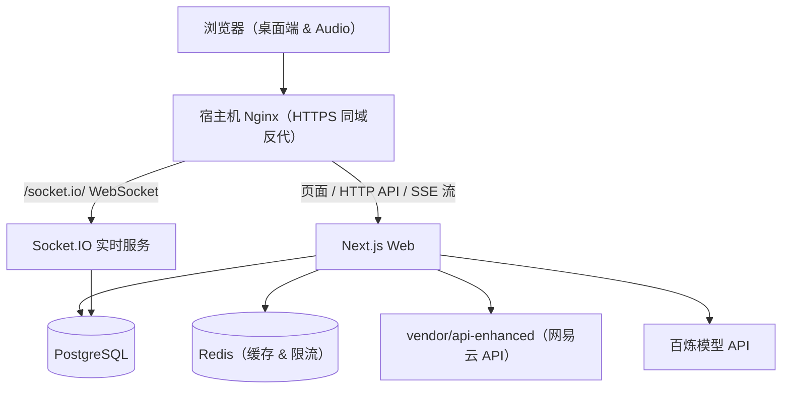

# POOL

桌面端在线一起听音乐全栈平台：支持朋友建房轮流上台带歌、多端时间轴同步听歌、实时聊天，以及房间结束后的 AI 共享回忆总结。

## 核心功能

- **账号与会话**：基于 Better Auth + PostgreSQL 的邮箱密码注册登录与 Cookie Session，支持资料修改与安全改密。
- **音乐搜索与喜欢收藏**：通过统一音源适配器接入网易云匿名曲库（搜索、详情、歌词、音频取流），支持个人播放器队列拖拽与最多 500 首喜欢及歌单链接导入。
- **多人一起听房间**：公开／密码房创建与大厅检索、上台轮播队列、全票／播主切歌、实时聊天（10 秒 5 条限流）及空房定时归档。
- **多端音频同步**：服务端 4 秒预加载窗口与起播锚点下发，客户端时钟校准、播放版本号防乱序及切后台重对齐。
- **AI 共享总结**：房间结束后由参与者触发，基于 Vercel AI SDK 流式生成并落库，同房成员共享同一份历史回顾。

## 技术栈

| 领域         | 技术选型                                                                 |
| ------------ | ------------------------------------------------------------------------ |
| 前端         | Next.js App Router、React 19、TypeScript、Tailwind CSS、shadcn/ui (Base UI) |
| 状态与请求   | TanStack Query、Zustand、Axios、TanStack Virtual、dnd-kit、React Hook Form |
| 后端与实时   | Next.js Route Handlers、独立 Socket.IO 进程、Zod、Better Auth            |
| 数据与缓存   | PostgreSQL、Drizzle ORM、Redis（Lua 原子限流与查询缓存）                 |
| AI           | Vercel AI SDK (`ai` / `@ai-sdk/react` / `@ai-sdk/openai-compatible`)、百炼 `qwen3.8-flash` |
| 测试与部署   | Vitest、Node Test 隔离数据库集成测试、Docker Compose、Nginx、GitHub Actions |

## 架构与目录



```text
POOL/
├─ src/app/                 # App Router 页面与 HTTP API 路由
├─ src/contracts/           # 前后端共享 DTO、房间命令与事件契约
├─ src/features/            # 按业务模块内聚的 UI、API 与 Query hooks
├─ src/lib/                 # Axios 实例、Socket 客户端、认证客户端与通知
├─ src/server/              # 认证、音乐适配、收藏、房间分层服务与 AI 链路
├─ socket-server/           # 独立 Socket.IO 进程入口
├─ drizzle/                 # 版本化数据库迁移 SQL
├─ deploy/                  # Nginx 配置模板与一键部署脚本
├─ tests/                   # 单元测试、React 生命周期测试与集成测试
└─ vendor/api-enhanced/     # 仓库内网易云上游源码（独立依赖与许可证）
```

## 工程亮点

- **时间轴同步播放**：采用“服务端起播锚点 + 4 秒预加载 + 客户端 RTT 时钟校准 + 播放版本号”代替高频进度广播，兼容浏览器自动播放限制与切后台重对齐。
- **并发与锁序控制**：服务端 `KeyedSerial` 按固定键序串行化用户与跨房操作，防止切换房间与断线清理交叉死锁；同用户多标签页合并为单一成员。
- **上游保护与降级**：音乐模块整合 Redis Lua 原子限流、Singleflight 请求合并与单实例 QPS/并发预算；Redis 异常时普通查询降级内存，高成本 AI 与导入入口安全拒绝。
- **独立产物与轻量 CI/CD**：Web 使用 Next.js `standalone`，Socket 与迁移脚本通过 `esbuild` 编译为单文件 ESM 产物；GitHub Actions 自动验证并在推送 `main` 后通过 SSH 触发服务器本地构建更新。

## 本地开发

需要 **Node.js 24+**、**pnpm** 与 **Docker Compose**。

1. **安装依赖并准备环境变量**

```sh
pnpm install
pnpm --dir vendor/api-enhanced install --frozen-lockfile --prod --ignore-scripts
cp .env.example .env
```

修改 `.env` 中的数据库密码、Redis 密码与随机 `BETTER_AUTH_SECRET`（至少 32 字符），确保 `DATABASE_URL`、`REDIS_URL` 中的密码与容器一致；需要联调真实总结时填写 `DASHSCOPE_API_KEY`。

2. **启动 PostgreSQL / Redis 并执行迁移**

```sh
pnpm infra:up
pnpm db:migrate
```

3. **在三个终端分别启动音源、Web 与 Socket 服务**

```sh
pnpm music:dev
pnpm dev
pnpm socket:dev
```

访问 `http://localhost:3000`（本地统一使用 `localhost` 以复用 Cookie，不混用 `127.0.0.1`）。停止基础设施容器可执行 `pnpm infra:stop`。

## 测试与部署

常用检查与测试命令：

```sh
pnpm typecheck
pnpm lint
pnpm format:check
pnpm test
pnpm test:integration   # 需先启动 PostgreSQL 与 Redis（使用隔离 schema/命名空间）
pnpm build
pnpm build:server
```

生产环境采用 [compose.production.yaml](compose.production.yaml) 管理 `web`、`socket`、`music`、`postgres`、`redis` 与一次性 `migrate` 容器，宿主机 Nginx 负责 HTTPS 同域分流；服务器更新可直接执行 `bash ./deploy/deploy.sh`，详细步骤与 CI/CD 密钥说明见 [部署指南](docs/部署指南.md)。

## 相关文档

- [项目概览](docs/项目概览.md)：总体选型、服务职责边界与业务规则
- [前端设计](docs/前端设计.md)：页面路由、组件分工、状态管理与交互规范
- [服务端设计](docs/服务端设计.md)：数据库模型、HTTP / Socket 契约与业务流程
- [部署指南](docs/部署指南.md)：生产容器、Nginx、备份恢复与轻量 CI/CD
