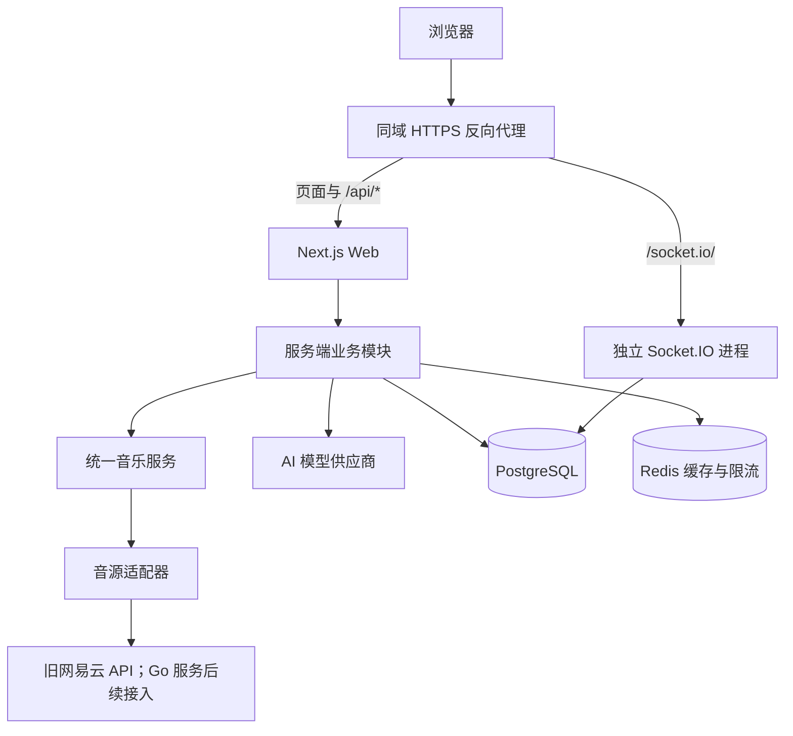
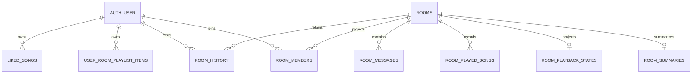

# POOL 服务端设计

## 1. 文档范围与状态

本文负责数据模型、DTO、服务端目录、HTTP / Socket 契约、响应与状态码、业务流程和数据生命周期。

当前账号基础后端已实现：Better Auth、PostgreSQL、Drizzle 迁移、Redis 认证限流、账号接口和页面鉴权。网易云音乐、收藏和导入也已接入；房间与 AI 服务仍为目标设计；本文对应业务表和接口未落地时不代表现有能力。账号见 [第二阶段文档](开发阶段/02-基础后端与账号系统.md)，音乐与收藏见 [第三阶段文档](开发阶段/03-网易云音乐与喜欢列表持久化.md)。

## 2. 架构与依赖方向



| 归属 | 负责的入口或状态 |
| --- | --- |
| Web | 认证、音乐查询及音频代理、喜欢及导入、房间创建与大厅查询、个人历史、AI 请求与总结 |
| Socket | 加入离开、成员及上台顺序、成员房间歌单、聊天、播放与投票、房主操作、空房结束及到期清理 |
| PostgreSQL | 持久业务数据、唯一约束、容量事务、总结生成状态 |
| Socket 进程内存 | 当前连接、在线成员、上台顺序、投票、房间操作锁、轮播定时器 |
| Redis | 可丢弃的曲库缓存与限流计数；不承载房间权威状态、广播或可靠任务 |

同一房间状态只保留一套写入入口；HTTP 不再提供修改房间设置、切歌等与 Socket 重复的写接口。共享代码不共享进程内 Map；涉及两进程共同写入的持久上限使用数据库事务协调。

### 当前账号实现

- Better Auth 1.7.18 + Drizzle ORM 0.45.4；同版本 CLI 生成 user、session、account、verification，迁移位于 drizzle/。不创建第二套账号和密码表。
- 注册邮箱密码账号后直接登录；密码 8～128 位，昵称去空白后 1～30 字符。暂不接邮件验证、邮件找回或账号注销。
- Cookie Session 有效期 7 天，持续使用满一天后续期。关闭 Cookie 会话缓存；数据库会话过期或撤销后不再授权。HTTPS 使用认证库的安全 Cookie，SameSite=Lax、HttpOnly。
- 昵称修改走原生 update-user；改密走 change-password，验证当前密码并在服务端强制撤销其他会话。
- Redis 自定义 consume 使用 Lua 原子计数：登录／改密每 60 秒 5 次，注册每 60 秒 3 次，其他认证写操作默认每 60 秒 120 次。get-session 和 sign-out 不走限流。超限 429 + Retry-After，限流不可用 503 LIMITER_UNAVAILABLE。
- 本地模式忽略客户端代理 IP，按端点共用限流桶；只有部署在覆盖 X-Forwarded-For 的可信反向代理后方才开启 AUTH_TRUST_PROXY。Redis 不持久化登录会话。
- 每个业务页面入口均读取真实会话；GET /api/account 独立校验 Cookie，只返回当前用户安全资料，接口忽略传入 userId。核心模块不依赖 Next 上下文，以便后续 Socket 复用。

### 当前音乐与收藏实现

- src/server/music/service.ts 是唯一音乐入口，netease 适配器实现五个操作；匿名调用源码运行的 api-enhanced，关闭默认解锁，bilibili 返回 CAPABILITY_NOT_SUPPORTED。
- liked_songs 已创建，联合主键 user_id + source + source_id，无内部歌曲 ID；added_at 为 timestamptz，稳定倒序。新增读取可信详情再保存快照，删除幂等。
- 新增、删除和导入在短事务内锁定认证用户行；外部请求在事务外完成。导入先用 Redis 120 秒租约限制同用户并发，读取预算 60 秒，成功读完所需分页后再按当前剩余容量一次提交。
- 导入固定页长 100，达到 500 容量停止。未读取条目数量不作为已知跳过数，capacitySkipped=null、hasMore=true。读取失败不写半份数据；当前支持完整标准／移动端／hash 歌单链接，不解析短链。
- Redis 缓存成功搜索 60 秒、详情 300 秒、歌词 24 小时、歌单及分页 120 秒；不缓存错误、用户喜欢或临时播放 URL。用户请求和上游启动预算分开，缓存命中也扣用户额度，具体额度见第三阶段文档。
- 音频默认 direct HTTPS，返回过期时间和服务端歌曲详情时长；只提供试听或无地址时返回 TRACK_UNPLAYABLE。stream 路由已实现鉴权与 Range 透传，只接受平台引用，不接受任意 URL。
- 普通音乐查询在 Redis 故障时退到单实例限流与无缓存调用，上游仍每秒最多 5 次启动、并发 3 个；批量导入返回 LIMITER_UNAVAILABLE。

## 3. 命名、身份与时间约定

- 数据库表和字段使用 snake_case；普通 JSON DTO 使用 camelCase。已确认的统一音乐资料保留 source_id、duration_ms、cover_url 等 snake_case 字段，嵌套在其他 DTO 中也不改名。
- 歌曲身份固定为 `(source, source_id)`，source 仅为 netease / bilibili；平台条目 ID 按字符串处理。Bilibili 分 P 引用完整保留 bvid、cid 等平台信息。
- 不创建独立 songs 表或内部歌曲 ID。房间、歌单项、消息等业务记录可有自己的 ID，它们不代表跨平台歌曲实体。
- 业务表持久时间使用 timestamptz；认证表沿用 Better Auth 生成 schema 的 timestamp 字段及库的日期映射。对外时间传输为 ISO 8601 UTC 字符串；前端按用户时区展示。时长、偏移量统一为毫秒；不能把未知时长当作 0。
- source_id、roomId、roomCode、itemId 分开使用：roomCode 用于加入，roomId 用于归档和总结，itemId 定位成员房间歌单中的一条记录。
- 请求身份从 Session 取得，普通请求不得通过 userId 指定当前操作者。来源 URL、Cookie、密钥等实现资料不进入音乐 extra；extra 只保存平台引用参数。

## 4. 数据库模型

### 4.1 表关系



下列 auth_user 表示 Better Auth 的用户模型，实际 user、session、account、verification 表名与列以选定版本生成的 schema 为准；不手写另一套密码、会话表。业务外键统一引用该用户主键。

### 4.2 通用曲目快照字段

liked_songs、user_room_playlist_items 和 room_played_songs 直接保存下列资料；不关联独立歌曲表。

| 字段 | 数据库类型 | 约束与含义 |
| --- | --- | --- |
| source | text | 必填，netease / bilibili |
| source_id | text | 必填、非空；保持平台身份稳定 |
| title、author、album | text | 可空；author 沿用平台含义 |
| duration_ms | integer | 可空，已知时为正数；音频精确时长与资料时长可能不同 |
| cover_url | text | 可空 |
| extra | jsonb | 可空对象，仅保存适配器可解释的平台引用 |

### 4.3 liked_songs：用户喜欢

| 字段 | 类型 | 说明 |
| --- | --- | --- |
| user_id | text | 用户外键 |
| 曲目快照字段 | 见 4.2 | 收藏时保存的统一资料 |
| added_at | timestamptz | 服务端生成，重复收藏不修改 |

- 主键或联合唯一：`(user_id, source, source_id)`；不额外设置歌曲 ID。
- 查询索引：`(user_id, added_at DESC, source, source_id)`。同一批导入时间可能相同，用身份作为稳定排序的第二依据。
- 每用户最多 500 首是跨行业务约束，不是单行 CHECK；添加与导入在同一用户的事务锁内检查、写入。
- 用户取消收藏后重新添加生成新的 added_at；不保存歌词、播放 URL。

### 4.4 rooms：活动房间及归档

| 字段 | 类型 | 说明 |
| --- | --- | --- |
| id / code | text | 主键 / 唯一房间号 |
| owner_id | text | 当前房主用户外键，仅用于活动房间权限，不作为总结授权依据 |
| name / tag | varchar | 名称 2～20 字符；标签 2～12 字符 |
| password_hash | text nullable | 空为公开房；不保存、返回明文密码 |
| max_members / max_stage_members | smallint | 房间人数 2～50、上台人数 1～30，且上台人数不超过房间人数 |
| status | text | active / ended |
| current_member_count | smallint | Socket 写入的在线人数投影，不作为独立在线权威来源 |
| last_active_at / empty_expires_at | timestamptz | 最近活跃、空房到期时间 |
| created_at / updated_at | timestamptz | 创建与更新 |
| ended_at / expires_at | timestamptz nullable | 结束时同时写入；expires_at = ended_at + 7 天 |

- 房间创建后无人加入、或最后一位成员离开后，空房 30 分钟结束；房主解散同样进入 ended，不立即物理删除。
- 可选房间密码长度 6～64 字符；房主最后一个连接离开后，沿用旧规则移交给仍在线、最早加入的成员，无其他成员时保留至房间结束。总结生成与查看不依赖 owner_id。
- 同一 id 对应一次房间生命周期，结束后不重新开放该 id；新房间创建新 id。
- 索引：`(status, last_active_at DESC)`、`(owner_id, status)`、`(status, empty_expires_at)`、`expires_at`。
- 一人一个有效自建房、同一用户同时加入一个房间等沿用旧规则，开发时按旧实现逐项对齐，不引入跨房间播放。

### 4.5 room_members 与 room_history：在线投影和访问凭证

| 表 | 字段 | 约束与用途 |
| --- | --- | --- |
| room_members | room_id、user_id、joined_at、left_at | `(room_id, user_id)` 主键；left_at 为空表示在线投影 |
| room_history | user_id、room_id、first_joined_at、last_joined_at | `(user_id, room_id)` 主键；历史展示和总结权限凭证 |

- room_members 是可重置的在线投影，不是总结授权表。可用 `user_id WHERE left_at IS NULL` 的部分唯一索引辅助限制一个有效房间；同房多标签页由内存连接集合计数。
- room_history 同一用户重复加入同房更新 last_joined_at，不增加条数。索引：`(user_id, last_joined_at DESC, room_id)`。
- 成功加入时，在用户事务锁内 upsert 历史、删除最旧超额记录，数据库中最多 50 条；用户主动删除走同一协调规则。
- 历史被删除或淘汰后，不能再凭 room_members 查看总结；仍在活动房间中重新成功加入时可重新生成历史。
- room_history 指向 rooms 归档，显示房间结束时的名称等资料。房间结束满 7 天一起删除；删除个人历史不删除房间、共享总结或其他人的历史。

### 4.6 user_room_playlist_items：成员独立房间歌单

| 字段 | 类型 | 说明 |
| --- | --- | --- |
| id | text | 歌单项主键，DTO 对应 itemId，不是歌曲 ID |
| user_id | text | 所属用户 |
| 曲目快照字段 | 见 4.2 | 可在未收藏时直接添加 |
| position | integer | 同一用户歌单内的排序位置 |
| created_at / updated_at | timestamptz | 写入和调整时间 |

- 沿用旧项目：成员有一份跨房间共用的上台歌单，与喜欢列表及个人播放器队列独立。
- 联合唯一：`(user_id, source, source_id)`；索引 `(user_id, position, id)`。每用户最多 500 首，达到上限拒绝新增，导入喜欢时填满剩余额度。
- 增删、排序、打乱、导入喜欢和清空由 Socket 服务处理；房间结束不清理这份用户歌单。

### 4.7 room_playback_states：当前播放时间轴

字段：room_id 主键、version、status（idle / playing）、active_stage_index、active_member_id、current_item_id、可空曲目快照、started_at、start_offset_ms、playback_duration_ms、updated_at。

- version 由服务端推进，客户端拒绝旧状态；过期播放错误上报不推进当前曲目。
- 无当前曲目时 status=idle，曲目、成员与起播时间可空；playing 必须拥有完整身份和起播锚点。
- playback_duration_ms 表示服务端用于节目调度的时长，与资料 duration_ms 分开。首版采用旧网易云服务端 getTrack 歌曲详情的毫秒时长，不信任客户端提交的时长；跨进程传递与缺失时长的准入方式仍需落实。Go/Bilibili 音轨时长后续处理，不能直接把整数秒视为精确值。
- 投票和上台队列只在内存维护，不新增持久投票表。服务重启将在线投影和播放置为等待，不承诺自动恢复上台顺序。

### 4.8 room_messages 与 room_played_songs：总结输入

| 表 | 字段 | 规则 |
| --- | --- | --- |
| room_messages | id、room_id、user_id、sender_name、content、created_at | 消息 ID 去重；发送者名称为展示快照；房间及时间索引 |
| room_played_songs | id、room_id、member_id、曲目快照、playback_version、played_at | 记录已经开始的节目，重复播放同曲目可有多条 |

- 单条消息最多 120 字符；每用户每 10 秒最多 5 条，多标签页共用额度，超限提示等待且不自动重发。精确 Unicode 计数方式在实现时统一；不提供结束后的聊天历史接口。
- 每房最多保存最近 10,000 条消息，超出删除最旧记录；数量淘汰允许早于 7 天，总结只分析当前保留记录，剩余数据在结束满 7 天清理。
- room_played_songs 唯一 `(room_id, playback_version)`，每房最多保留最近 500 条；曲目预加载不算已经开始播放。
- 索引分别为 `(room_id, created_at, id)`、`(room_id, played_at DESC, id)`。消息、播放记录都在房间结束满 7 天清理，总结生成成功时不提前删除。

### 4.9 room_summaries：共享总结及生成锁定

| 字段 | 类型 | 说明 |
| --- | --- | --- |
| room_id | text | 主键，每房一份状态记录 |
| status | text | generating / failed / succeeded |
| attempt_id | text | 当前生成尝试标识，隔离已失效尝试的回写 |
| requested_by | text | 触发成员；只用于服务端记录 |
| content | text nullable | 完整生成并保存成功后的正文，不提供主动删除 |
| started_at / generated_at | timestamptz nullable | 当前尝试开始及首次成功时间 |
| error_code | text nullable | 可重试错误分类，不存供应商凭据或完整错误栈 |

- 没有记录表示未生成；expires_at 从 rooms 读取，避免按生成时间另起 7 天。
- 在事务内检查房间结束、未过期、请求者有历史，以及总结状态，再占用生成资格；不能先调用模型再靠唯一键处理重复结果。
- generating 拒绝重复启动；failed 允许限额内手动重试；succeeded 直接读取，不再生成，也不可主动删除。
- 成功标记与正文一起保存，房间结束满 7 天连同房间清理；生成和查看只检查历史凭证，不区分房主与普通参与者。进程中断后的 generating 识别与恢复方式待定，正常单次模型调用上限为 60 秒。

### 4.10 外键与清理顺序

用户自有数据引用认证用户；房间相关历史、消息、播放记录、总结、在线投影引用 rooms，可在最终物理清理时级联删除。owner_id 不采用用户删除即无条件级联整个房间的策略，避免误删其他参与者归档；账号注销流程尚未纳入首版。

Socket 结束房间时先取消定时器、处理成员连接并写 ended_at / expires_at；清理任务仅处理已结束且到期的房间，配合正在生成总结的终止或回写校验。请求入口立即拒绝到期访问，清理任务允许稍后执行。用户喜欢与个人房间歌单不随房间删除。

## 5. DTO 与统一响应

### 5.1 音乐契约

```ts
/** 用于稳定标识平台，接口实现名称不进入歌曲身份。 */
type MusicSource = 'netease' | 'bilibili'

/** 用于跨业务保存、传递平台曲目引用，extra 仅由适配器解释。 */
type TrackRef = {
  source: MusicSource
  source_id: string
  extra: Record<string, unknown> | null
}

/** 用于搜索、收藏和房间歌单的统一歌曲资料快照。 */
type TrackDto = TrackRef & {
  title: string | null
  author: string | null
  album: string | null
  duration_ms: number | null
  cover_url: string | null
}

/** 用于一次播放的临时资源，不持久保存 URL。 */
type PlaybackResourceDto = {
  url: string
  delivery: 'direct' | 'proxy'
  mime_type: string | null
  expires_at: string | null
  duration_ms: number | null
}

/** 用于歌词展示和 AI 抽样，空歌词不等于请求失败。 */
type LyricsDto = {
  lrc: string | null
  translationLrc: string | null
}

/** 用于统一 offset 分页；无法确定的总数或后续页信息返回 null。 */
type PageDto<T> = {
  items: T[]
  offset: number
  limit: number
  total: number | null
  hasMore: boolean | null
}
```

平台引用必须非空，extra 允许 null；其他空资料不改成伪造歌名或虚假时长。getPlaylistTracks 的 data 为 `{ playlist: { source, source_id, title, cover_url }, tracks: PageDto<TrackDto> }`；标题及封面可空。

### 5.2 普通响应与 Socket acknowledgement

```ts
/** 用于普通 JSON 业务请求的成功结果。 */
type ApiSuccess<T> = {
  ok: true
  data: T
  requestId: string
}

/** 用于字段定位、业务错误分类和限流等待提示。 */
type ApiFailure = {
  ok: false
  error: {
    code: string
    message: string
    fieldErrors?: Record<string, string[]>
    retryAfterSeconds?: number
    details?: Record<string, unknown>
  }
  requestId: string
}

/** 用于 HTTP JSON 与 Socket 命令确认的统一结果联合。 */
type ApiResult<T> = ApiSuccess<T> | ApiFailure
```

- HTTP 使用真实状态码，不把失败全部包装成 200；成功无数据统一返回 `data: null`，DELETE 使用 200 以保留响应结构。
- Socket 命令确认使用同一结果联合，不虚构 HTTP 状态码；广播推送使用事件 DTO，不加请求响应外壳。requestId 由入口生成，用于请求或命令排查。
- Better Auth 的 `/api/auth/*` 保留库自有协议；AI 流、音频流不套 JSON 外壳。播放器通过鉴权的音频路由读取真实媒体字节。
- 个性化业务结果、总结、临时播放资源不进入公开共享 HTTP 缓存；Redis 缓存按平台、参数和必要的账号作用域区分。

### 5.3 其他业务 DTO

| DTO | 字段与用途 |
| --- | --- |
| LikedSongDto | TrackDto + addedAt；不返回 userId |
| ImportLikesResultDto | added、duplicates、failed、capacitySkipped、remainingCapacity、hasMore；上游剩余总数未知时 capacitySkipped 可空，不能杜撰未读取的数量 |
| CreateRoomDto | name、tag、password（可省）、maxMembers、maxStageMembers |
| RoomListItemDto | roomId、roomCode、name、tag、ownerName、memberCount、maxMembers、maxStageMembers、isPasswordProtected、lastActiveAt |
| RoomMemberDto | userId、name、image、joinedAt、isOwner；image 可空 |
| RoomPlaylistItemDto | itemId、position、track: TrackDto |
| RoomPlaybackDto | roomId、roomCode、version、status、activeMemberId、currentItemId、track、startedAt、startOffsetMs、durationMs、skipVoteCount、skipVoteRequired、skipVoterIds |
| ChatMessageDto | id、roomId、senderId、senderName、content、createdAt |
| RoomJoinResultDto | room: RoomListItemDto、members、stageMembers、messages、myPlaylist、playback；加入和重连的完整快照 |
| RoomHistoryDto | roomId、roomCode、name、ownerName、lastJoinedAt、endedAt、expiresAt、status；时间字段未结束时可空 |
| RoomSummaryDto | roomId、status（notGenerated / generating / failed / succeeded）、content、generatedAt、expiresAt；非成功状态不提供正文 |

RoomPlaybackDto 的空闲状态允许 track、startedAt、activeMemberId、currentItemId、durationMs 为空。所有推送应带房间身份，客户端只处理当前房间的数据。服务端模型、数据库行与可返回 DTO 分开，password_hash、会话凭据等不经过通用对象展开返回。

## 6. HTTP 状态码与业务错误码

| HTTP | code 示例 | 场景 |
| --- | --- | --- |
| 200 | 无错误码 | 查询、操作成功 |
| 201 | 无错误码 | 新建收藏或房间成功 |
| 400 | INVALID_INPUT、INVALID_PLAYLIST_LINK | 参数、JSON 或平台链接格式错误 |
| 401 | UNAUTHENTICATED | 未登录或会话失效 |
| 403 | FORBIDDEN、ROOM_HISTORY_REQUIRED | 房主权限不足、没有总结访问凭证 |
| 404 | TRACK_NOT_FOUND、ROOM_NOT_FOUND | 平台条目或业务记录不存在 |
| 409 | LIKES_LIMIT_REACHED、ALREADY_IN_ROOM、ROOM_FULL、SUMMARY_GENERATING、SUMMARY_LOCKED、ROOM_NOT_ENDED | 当前业务状态不允许操作 |
| 410 | ROOM_EXPIRED | 到期但尚未物理清理的归档；清理后为 404 |
| 422 | TRACK_UNPLAYABLE | 参数有效，但该条目当前不能播放 |
| 429 | RATE_LIMITED | POOL 用户、账号、房间或上游预算超限；提供 Retry-After |
| 501 | CAPABILITY_NOT_SUPPORTED | 音源或能力尚未接入 |
| 502 | UPSTREAM_UNAVAILABLE、UPSTREAM_RATE_LIMITED、AI_UNAVAILABLE | 外部失败；上游限流与 POOL 本地 429 分开，必要时提供重试时间 |
| 503 | LIMITER_UNAVAILABLE | 限流不可用，高成本调用暂停 |
| 503 | AI_BUSY | 全站 AI 已有 10 个并发任务，提示繁忙，不进入等待队列 |
| 504 / 500 | UPSTREAM_TIMEOUT / INTERNAL_ERROR | 上游超时 / 未分类服务端失败 |

上游返回 HTTP 200 也需要校验业务状态；不得仅依据 HTTP 成功判定可播放。未登录先返回 401，再判断资源与权限。意外错误在入口统一映射及记录，单个逻辑不层层 try/catch。

## 7. HTTP URL 与接口草稿

所有业务接口同域以 `/api` 开头，Cookie Session 鉴权。分页默认 offset=0、limit=20；limit 必须为 1～500，具体入口可收紧。source、id 为查询参数时均需要 URL 编码。

### 7.1 音乐与喜欢

| 方法与 URL | 输入 | 成功 data | 备注 |
| --- | --- | --- | --- |
| GET /api/music/search | source、q、offset、limit | PageDto<TrackDto> | 用户选择源；未接入返回 501 |
| GET /api/music/track | source、id | TrackDto | 服务端读取或解析所需 extra |
| GET /api/music/lyrics | source、id | LyricsDto | 无歌词返回两项 null；上游失败单独报错 |
| POST /api/music/playback | body: TrackRef | PlaybackResourceDto | 解析临时资源，不自动跨源替换 |
| GET /api/music/playlist-tracks | source、url、offset、limit | 歌单资料 + PageDto<TrackDto> | 只读取资料，不写收藏 |
| GET /api/music/stream | source、id | 音频字节 | 服务器解析引用与上游 URL；支持 Range，不接收任意远程 URL |
| GET /api/likes | offset、limit | PageDto<LikedSongDto> | addedAt 倒序，稳定第二排序 |
| POST /api/likes | body: `{ track: TrackDto }` | `{ item: LikedSongDto, added: boolean }` | 重复为 200、不改时间；新增 201 |
| DELETE /api/likes | source、id | null | 幂等取消，不存在亦成功 |
| POST /api/likes/import | body: `{ source: 'netease', url: string }` | ImportLikesResultDto | 服务端取歌单，按剩余容量导入 |

GET 的 source + id 足以解析网易云和 Bilibili 复合引用；若未来平台不能重建 extra，需要调整契约，不要求用户先收藏才能查询。代理基于源和身份重新解析资源，鉴权失败不能返回登录页 HTML 冒充音频。

导入接口不接收客户端给出的 userId 或容量余额；成功导入部分条目为 200，数量反馈依实际读取范围计算。事务不包住所有外部网络请求，先读取资料，再用短事务锁用户、重新计算容量并插入。

### 7.2 房间、历史及认证

| 方法与 URL | 输入 | 成功 data | 备注 |
| --- | --- | --- | --- |
| /api/auth/* | Better Auth 自有协议 | 自有响应 | 已实现注册、登录、会话、退出、昵称／密码修改；不二次包装 |
| GET /api/account | Cookie Session | 当前用户 id、email、name、image、emailVerified、createdAt | 已实现，忽略客户端 userId，无会话返回 401 |
| GET /api/rooms | q、offset、limit | `{ rooms: PageDto<RoomListItemDto>, myRoom: RoomListItemDto \| null }` | 大厅公开房列表；房间号可查询受密码保护房的安全摘要，不泄露密码或聊天 |
| POST /api/rooms | CreateRoomDto | RoomListItemDto | 201；ownerId 来自 Session，一人一个有效房间 |
| GET /api/room-history | offset、limit | PageDto<RoomHistoryDto> | 数据库最多 50 条；不含已到期房间 |
| DELETE /api/room-history/[roomId] | 路径参数 | null | 只删当前用户凭证；不删共享总结 |
| GET /api/rooms/[roomId]/summary | 路径参数 | RoomSummaryDto | 检查历史与到期；后期功能 |
| POST /api/rooms/[roomId]/summary | 无额外业务参数 | AI 流，见 7.3 | 任意有凭证的参与者；结束后、过期前触发 |

总结不提供删除接口；查看与生成需要有效 room_history，不检查 owner_id 或当前在线成员身份。房间创建号和归档 ID 不混用。不提供独立 HTTP join、leave、skip、修改房间设置接口。

### 7.3 AI 流接口

- `POST /api/ai/liked-playlist-analysis`：从当前用户的喜欢列表读取资料，空列表返回业务错误，不由客户端上传任意账号歌单。
- `POST /api/rooms/[roomId]/summary`：服务端读取房间最近 500 条播放记录、抽样歌词及最新 12,000 字符聊天，生成共享结果。
- 统一使用 Vercel AI SDK，服务端通过 ai 的 streamText 调用模型 provider，并使用 SDK 提供的响应工具输出原生 UI message stream（SSE）。具体包版本在实施时统一锁定，按对应版本的官方协议连接前端。
- 鉴权、限流与生成资格检查在响应流开始前完成，失败使用普通 JSON 和真实错误状态码；流开始后使用 SDK 原生错误通道，不把错误拼入生成正文。错误展示由服务端映射为业务可读信息，requestId 用响应头关联排查。
- 房间已有成功总结时返回普通 JSON 的 RoomSummaryDto，客户端依据 Content-Type 分别处理；generating 返回 409，其他成员通过 GET 查询同一份状态，禁止启动第二次模型调用。
- 房间总结只有在完整生成且数据库成功保存后才进入 succeeded；SDK 流结束与数据库落库成功是不同状态。业务 hooks 以总结查询结果确认成功，不仅凭客户端收到了结束事件。
- 提示词、模型密钥和 provider 配置只在服务端；歌单分析最多输出 1,200 token，房间总结最多 2,000 token。因输出上限而截断的结果不算完整成功，总结不进入 succeeded，允许额度内手动重试。
- 从模型调用起计时，单次最多 60 秒；超时取消模型请求、记录失败并释放并发名额。SDK 与业务层均不自动重试，手动重试计入原有频率和日额度。
- Web 单实例统一限制歌单分析与总结共 10 个并发任务，每用户分析和每房总结仍各最多 1 个；启动模型前取得名额，满额返回 AI_BUSY，不排队，也不消耗模型生成次数。
- 首版没有独立 worker；流断开、进程重启后的生成取消及状态恢复仍待确认。不得仅因页面显示部分文字就把状态标为成功。

### 7.4 音频响应例外

音频代理成功使用原始媒体 Content-Type 和 200 / 206；Range 无法满足时使用 416，并正确处理 Content-Range。只有播放前业务错误使用 JSON。代理不能接受任意远程 URL、不能把会话 Cookie 传给音源，也不能公开 Go 或旧 API 的账号设置接口。

## 8. Socket 事件契约

握手复用同域 Session；命令字段使用当前 Socket 的身份和房间绑定，不接受伪造 userId。以下字段为草稿，与 HTTP DTO 共享 definitions；ack 使用 ApiResult。

| 客户端命令 | 载荷 | 成功 ack data |
| --- | --- | --- |
| room:join | roomCode、password? | RoomJoinResultDto |
| room:switch | roomCode、password? | RoomJoinResultDto；显式确认后退出旧房 |
| room:leave | 无 | null |
| room:stage:join | 无 | 成员与上台快照 |
| room:stage:leave | targetUserId? | 成员与上台快照；移除他人需房主 |
| chat:send | content | `{ messageId }`，正文由广播进入列表 |
| room:playlist:add | track: TrackDto | `{ items: RoomPlaylistItemDto[] }` |
| room:playlist:remove | itemId | 最新个人房间歌单 |
| room:playlist:reorder | itemId、toIndex | 最新个人房间歌单 |
| room:playlist:shuffle / import-liked / clear | 无 | 最新个人房间歌单 |
| room:playback:skip | 无 | RoomPlaybackDto；仅当前播放者 |
| room:playback:vote-skip | 无 | RoomPlaybackDto；同一用户同节目只计一票 |
| room:playback:media-error | version、itemId | 当前 RoomPlaybackDto；仅当前播放者上报可推进 |
| room:update-settings | name、tag、maxMembers、maxStageMembers、passwordAction、password? | 房间安全快照；passwordAction=keep / set / remove |
| room:kick-member | targetUserId | 最新成员快照；仅房主 |
| room:dissolve | 无 | null；只结束和归档，不立即硬删 |

| 服务端事件 | 载荷与前端行为 |
| --- | --- |
| room:presence | 房间身份、成员及上台顺序快照；替换当前房间投影 |
| room:playback | RoomPlaybackDto；仅接收当前房间且版本不旧的状态 |
| chat:message | ChatMessageDto；按消息 ID 去重，客户端近期列表限制为 200 条 |
| user:room-playlist | 用户自己的最新房间歌单，发送至其全部连接 |
| room:forced-leave | roomCode、reason（switched / kicked）；清理对应状态 |
| room:dissolved | roomId、roomCode；停止音频并退出活动房 |

切歌和投票沿用旧权限；不要把 media-error 的版本校验误写成“所有旧项目命令都带版本”。自动轮播和成员离开使用同一房间操作顺序，避免两个独立定时器推进同一房间。Socket 失去确认时先拉取加入快照或检查状态，不盲目自动重放有副作用的命令。

## 9. 业务流程

### 9.1 搜索、收藏及导入

1. 登录用户选择 source，提交关键词；Web 入口校验、限流，统一服务访问缓存和适配器。
2. 适配器将上游资料、单位、分页和错误转换成 DTO，业务页面只接收统一结构。
3. 收藏在用户事务锁内检查重复、容量并写入快照；重复为成功但 added=false。
4. 导入只读取填满剩余容量所需的分页；读完资料后事务内重新计算额度，不覆盖已有条目。失效曲目或上游局部错误按实际可处理范围反馈，不伪造整张歌单都已导入。

### 9.2 加房、轮播与重连

1. 创建房间经 HTTP，进入活动页后发送 room:join；成功加入才写 room_history，错误密码不计入历史。
2. Socket 按房间及用户协调顺序检查密码、容量、其他房间状态，更新连接集合、持久投影和历史，返回完整快照。
3. 上台后按固定顺序轮播成员各自歌单；客户端通过 HTTP 解析临时资源，取得起播锚点后计算目标位置。
4. 个人播放和房间播放互斥；加载失败与浏览器自动播放限制分别提示。音频 media-error 只有当前播放者的有效节目上报可推动跳歌，不因普通听众网络失败改变全房节目。
5. 仅在当前房间页内断线重连，重新加入并获取全量快照，使用最新版本和锚点恢复；服务重启则清空在线及上台状态、播放 idle，保留持久歌单与归档数据。
6. 离开房间页发送 room:leave，停止音频并取消本页连接与重连；无法发送时由断开连接处理离线。服务端按剩余连接判断用户是否仍在线，最后连接离开后更新成员与上台状态；用户退房不等于房主解散，不删历史及个人房间歌单。

### 9.3 结束、总结及清理

1. 最后成员离开后启动 30 分钟空房倒计时；重新有人加入时取消。房主解散直接结束。
2. 结束固定 endedAt 和 expiresAt；房间从大厅消失，历史页可以查看归档与触发总结。
3. 有历史凭证的参与者手动请求；数据库争取唯一生成资格后调用模型，成功写入共享正文及成功标记，失败允许限额内重试。
4. 删除或淘汰个人历史会移除本人生成与查看权限，不影响其他参与者；共享总结不可主动删除或重新生成。
5. 结束满 7 天立即拒绝读取和生成；清理任务最终删除房间及其关联数据，包含从未生成总结的聊天和播放记录，不删除用户的喜欢或独立房间歌单。

## 10. 服务端文件目录

```text
POOL/
├─ src/
│  ├─ app/api/                  # Next Route Handlers：鉴权、校验、响应适配
│  │  ├─ auth/[...all]/
│  │  ├─ music/                 # search、track、lyrics、playback、playlist-tracks、stream
│  │  ├─ likes/                 # route.ts 与 import/route.ts
│  │  ├─ rooms/                 # 大厅、创建及 [roomId]/summary
│  │  ├─ room-history/          # 本人列表及 [roomId] 删除
│  │  └─ ai/liked-playlist-analysis/
│  ├─ contracts/               # 可被前后端和 Socket 引用的 DTO、校验契约
│  │  ├─ response.ts
│  │  ├─ music.ts
│  │  ├─ likes.ts
│  │  ├─ room.ts
│  │  └─ ai.ts
│  └─ server/                  # 仅供服务端，不被浏览器代码导入
│     ├─ auth/                 # framework-neutral core 与 Next 会话读取
│     ├─ db/                   # client.ts、schema/，生成迁移交给 drizzle/
│     ├─ music/                # service.ts、errors.ts、adapters/netease.ts
│     ├─ likes/                # 收藏、事务容量与导入
│     ├─ rooms/                # 创建、持久歌单、历史及保留规则
│     ├─ ai/                   # AI SDK provider、取样、生成状态及原生流响应
│     └─ cache/                # Redis client、缓存和限流
├─ socket-server/
│  ├─ index.ts                 # Node 入口、握手及事件注册
│  ├─ room-service.ts          # 在线状态、权限与房间命令
│  ├─ playback.ts              # 时间轴、版本、轮播和投票
│  └─ maintenance.ts           # 空房结束、到期扫描与启动修复
├─ drizzle/                    # 可审阅的 schema 迁移
├─ deploy/                     # Compose、容器构建和反向代理
├─ tests/                      # 跨模块、双进程和多客户端验证
└─ docs/
```

简单数据库逻辑放所属业务模块，不预建每表一个 repository。Next 专用上下文模块不能被独立 Socket 入口引用；共享 DTO 不包含数据库连接和密钥。前端目录另见前端设计。

## 11. 缓存、限流与部署

- 缓存键包含 schema 版本、source、完整查询或条目引用、分页及必要账号作用域；相同 id 的不同平台或分 P 不能串缓存。上游失败不伪装成无歌词缓存。
- 曲库缓存可回源；AI 与导入在限流不可用时拒绝。用户请求额度与每音源实际调用预算分别统计；音频 Range 字节请求与“解析播放地址”的额度不是同一项，代理连接和带宽预算另定。
- 限流建议数值沿用项目概览，本文不复制第二份；Lua 原子计数不会替代 PostgreSQL 的总结成功锁定。
- Docker Compose 同一主机部署，公开入口只暴露反向代理；/socket.io/ 保留轮询和升级，AI 流不缓冲。数据库持久卷、备份和统一迁移步骤独立配置。
- Next 与 Socket 各一个实例；两进程的外部音乐请求目前只从 Web 发出，避免误认为两套内存预算共享。上线前确认实际模型价格、音源授权及自托管条款。

## 12. 待确认与验证清单

| 项目 | 当前处理 |
| --- | --- |
| 播放时长与加载同步 | 首版时长来源已定为网易云服务端歌曲详情；跨进程传递、缺失准入及加载同步仍需落实 |
| Go 接入、Bilibili | 后续补 JSON 能力和适配；首版未接通明确 501 |
| 容量与频率 | 房间歌单 500 首、聊天最近 10,000 条、每用户每 10 秒 5 条；详细数值统一见项目概览 |
| AI 供应商及流中断恢复 | 后期总结开发时决定，数据库状态及 attemptId 已预留 |
| 用户设置 | 首版页面仅定义本地偏好和退出；资料修改等接口未确认不先增加 |
| 正确性验证 | 收藏与房间歌单各不超 500、历史不超 50、聊天不超 10,000、AI 全站并发不超 10、总结过期及历史权限、旧版播放上报无效、双进程鉴权 |
| 音乐验证 | 两源引用稳定、空资料、无歌词、上游失败、Range 与媒体类型、账号 Cookie 不外泄 |

文档依据：[PostgreSQL 约束](https://www.postgresql.org/docs/current/ddl-constraints.html)、[部分索引](https://www.postgresql.org/docs/current/indexes-partial.html)、[事务一致性](https://www.postgresql.org/docs/current/applevel-consistency.html)、[Next.js 服务端访问](https://nextjs.org/docs/app/guides/backend-for-frontend)。
