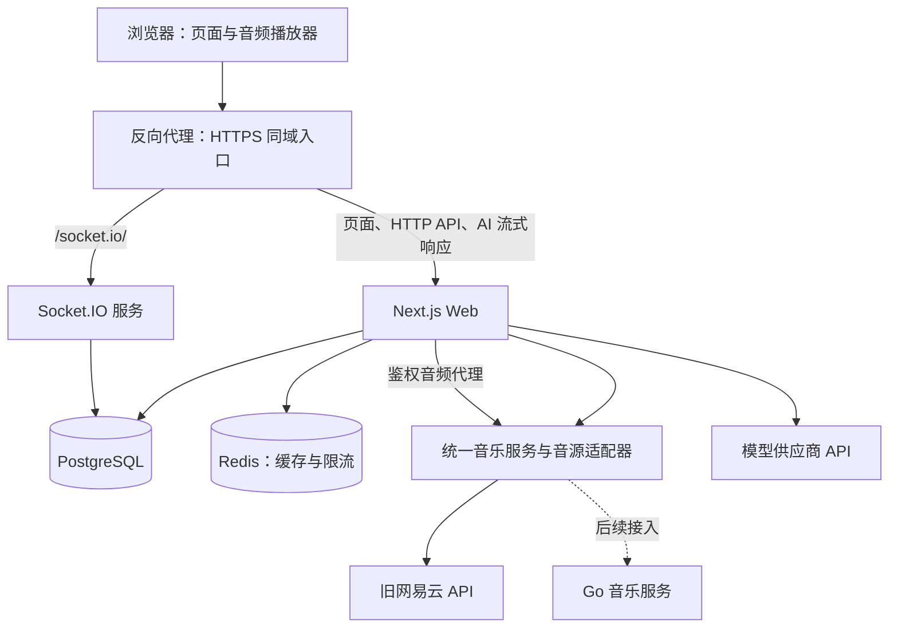

# POOL 在线一起听音乐平台

## 设计文档

- [第一阶段：前端交互原型](开发阶段/01-前端交互原型.md)：当前阶段先用 mock 实现全部页面的桌面交互原型，后续接入真实后端。
- [第一阶段完成情况与后端接入准备](开发阶段/01-前端原型完成情况与后端接入准备.md)：当前交付、验证范围及基础后端与账号系统的接入点。
- [服务端设计](服务端设计.md)：数据表、模型与 DTO、统一响应、状态码、HTTP / Socket 接口、业务流程及服务端目录。
- [前端设计](前端设计.md)：页面路由、组件拆分、前端状态与目录、播放器交互及 UI 风格。
- 本项目概览保留总体选型、架构和已确认决策；详细设计描述目标架构，未决项明确标注。当前已落地第一阶段 mock 前端代码，真实后端尚未接入，具体交付与验收见阶段文档。

## 技术栈

**Web 前后端**：Next.js App Router + TypeScript

**实时服务**：独立 Node.js 进程 + Socket.IO

**前端包管理器**：pnpm

**前端状态管理**：Zustand

**CSS 框架**：Tailwind CSS

**组件库**：shadcn/ui

**表单**：React Hook Form

**虚拟列表**：TanStack Virtual

**前端 Hooks 库**：ahooks

**HTTP 请求**：Axios

**服务端状态管理**：TanStack Query

**运行时类型校验**：Zod

**类型检查**：tsc --noEmit

**前端代码规范**：ESLint + Prettier

**测试**：Vitest

**ORM + 数据库迁移**：Drizzle

**数据库**：PostgreSQL

**认证**：Better Auth（Session，邮箱＋密码登录）

**缓存与限流**：Redis

**AI 开发**：Vercel AI SDK（ai + @ai-sdk/react，模型供应商通过 provider 适配）

**音乐源**：网易云音乐、Bilibili

## 项目架构

### 总体结构（草稿，待实现）

采用单仓库、按业务模块组织的全栈应用。Next.js Web 与独立 Socket.IO 服务是两个进程，共享服务端模块、数据库定义和通信契约；首版两者均为单实例，使用 Docker Compose 部署在同一台云服务器。



统一音乐服务是 Web 进程内的模块，不另起微服务。浏览器通过 POOL 接口获取音乐资料和播放资源，不直接调用旧 API 或 Go 服务；delivery=direct 时可读取已解析的音频直链，delivery=proxy 时读取 POOL 鉴权代理路由。

### 服务职责与写入边界

| 模块或进程 | 职责 | 不承担的职责 |
| --- | --- | --- |
| Next.js Web | 页面、认证、音乐查询与取流、喜欢列表与导入、房间创建与大厅查询、个人房间历史、AI 分析及总结 | 不维护在线成员、上台队列、播放锁和房间定时器 |
| Socket.IO 服务 | 加入与离开、在线成员、上下台、房间内歌单修改、聊天、切歌与投票、房主设置及解散、房间结束与过期清理 | 不直接请求外部曲库或模型，不另存一套用户账号 |
| 共享服务端模块 | 数据库连接与 schema、认证核心、统一音乐契约、持久业务规则 | 不依赖浏览器对象；跨进程共享代码不等于共享内存 |
| PostgreSQL | 账号与会话、收藏、房间基础信息、成员房间歌单、聊天、播放记录、房间历史与总结 | 不逐秒更新播放进度 |
| Redis | 曲库缓存、请求频率与调用额度计数 | 不作为房间权威状态、消息总线或可靠任务队列 |

- HTTP 创建房间后由 Socket 服务处理实际加入；大厅从数据库读取房间信息及 Socket 服务写入的在线人数投影，加入能否成功由 Socket 服务当时的状态决定。
- 房间创建之外的房间设置、解散及房间内歌单变更走 Socket 命令，服务端校验当前成员身份和操作权限，保存后广播；同一类状态不提供第二套 HTTP 写入入口。
- 客户端将经过统一接口获取的曲目引用和资料提交到房间；Socket 服务校验统一结构与房间规则。播放地址和歌词由各客户端经 Web 按需获取，不放入广播或持久记录。
- 活跃房间的连接、在线成员、上台顺序、投票、锁和定时器由 Socket 进程内存管理；播放版本与时间轴可写入数据库，作为快照和记录，进程重启仍按既定规则重置为等待。
- 收藏及导入容量由 Web 进程负责协调；房间操作由 Socket 进程按房间顺序处理；跨请求的总结成功锁定、历史上限及唯一性等持久约束由数据库事务和约束保证。

### 前端数据与播放器

- 普通 HTTP 数据使用 TanStack Query：音乐搜索、歌词、喜欢列表、房间大厅和历史。更新成功后更新或失效对应查询；账户会话由认证客户端管理。
- 当前已加入房间的成员、聊天、房间歌单、播放时间轴和连接状态由房间页内、Socket 事件驱动的 Zustand store 维护；同一份实时快照不再复制到 Query 缓存。房间变更后可让大厅查询失效；仅在房间页内重连并通过完整快照校准。
- Zustand 还可管理个人播放队列、音量和跨页面面板状态；局部交互用组件状态，表单输入由表单组件管理。
- 应用布局持有常驻个人音频控制器；房间连接和房间音频控制器仅属于房间页，离开即退房停音、取消请求与重连、清空快照，不跨页保留房间播放器。个人播放和房间播放互斥；Audio、Socket 及计时器保存在对应控制器或 ref 中，不持久化到 store。
- 客户端经 HTTP 客户端调用 POOL API；服务端渲染需要数据时直接调用已鉴权的服务端模块，不绕一圈请求自己的 HTTP API。

### 认证与请求处理

- 同域 Cookie Session 用于 HTTP 与 Socket 握手；Socket 服务复用独立于 Next.js 请求上下文的认证核心，通过请求头校验会话，不信任客户端提交的 user_id。
- HTTP 和 Socket 入口校验请求参数及身份，业务服务校验权限与业务规则；音源适配器负责上游响应校验、单位和错误转换，不在模块之间重复判空。
- 页面访问控制不替代接口鉴权；Socket 建连鉴权不替代每条命令的房间权限校验，退出登录或会话失效时断开连接。

### 目录草稿

```text
POOL/
├─ src/
│  ├─ app/                 # 页面、布局及 api 路由，保持入口轻薄
│  ├─ features/            # music、likes、room、player、ai 等前端业务模块
│  ├─ components/          # 通用 UI 与布局
│  ├─ lib/                 # 浏览器 HTTP、Socket、Query、认证客户端
│  ├─ stores/              # 客户端跨页面状态及当前房间快照
│  ├─ contracts/           # 音乐 DTO、事件与校验契约，允许两端引用
│  └─ server/              # 仅供服务端使用，不进入浏览器依赖
│     ├─ auth/             # 认证核心及不同入口的会话读取
│     ├─ db/               # 数据库连接与 Drizzle schema
│     ├─ music/            # 统一服务、音源适配器与代理取流
│     ├─ likes/            # 收藏与导入规则
│     ├─ rooms/            # 房间持久记录、历史与保留规则
│     ├─ ai/               # 生成、输入预算及总结状态
│     └─ cache/            # Redis 缓存与限流
├─ socket-server/
│  ├─ index.ts             # 独立 Node 入口与 Socket 事件注册
│  ├─ room-service.ts      # 在线房间、成员、歌单与权限协调
│  ├─ playback.ts          # 播放时间轴、版本、轮播与投票
│  └─ maintenance.ts       # 空房结束及到期数据清理
├─ drizzle/                # 数据库迁移
├─ tests/                  # 跨模块与多客户端验证；单元测试可就近放置
├─ deploy/                 # Compose、容器构建与反向代理配置
└─ docs/
```

目录按实际复杂度增减，不为单次逻辑预建 repository、manager 等层级；跨进程复用模块不导入 Next.js 专用上下文接口，浏览器代码只引用共享契约与客户端模块。

### 部署与维护

- Compose 包含反向代理、Web、Socket.IO、PostgreSQL、Redis 和首版旧网易云 API；Go 音乐服务后续接入。仅反向代理暴露公网，数据库、Redis、音乐服务走内部网络。
- 反向代理将 /socket.io/ 的轮询与 WebSocket 请求转发至 Socket 服务，其余业务请求交给 Web；支持连接升级，超时覆盖心跳周期，AI 流式响应关闭缓冲。
- Web 和 Socket 共用数据库及认证配置，各自持有连接池；数据库使用持久卷和备份，迁移由部署步骤统一执行，不由两个进程分别自动执行。
- Socket 单实例负责空房 30 分钟结束、结束后 7 天清理，启动时补扫已到期记录；到期访问和生成由请求入口直接拒绝，不依赖清理任务恰好运行。
- 首版 AI 由 Web 请求触发并流式返回，生成状态存数据库；失败可重试，不新增独立 worker 或消息队列。进程中断后的任务恢复方式在总结功能开发时细化。

### 尚待落实

- 首版调度时长使用旧网易云服务端歌曲详情；跨进程传递、时长缺失时的房间准入及音频加载期间的同步策略仍需落实，Go/Bilibili 音轨时长后续处理。
- AI 供应商、任务中断与重试细节；Go JSON 路由及适配器接入。
- 数据库字段、索引和具体事件定义在开发对应模块时细化；本节描述目标草稿，不表示代码已实现。

文档参考：[Next.js 服务端数据访问](https://nextjs.org/docs/app/guides/backend-for-frontend)、[Socket.IO 反向代理](https://socket.io/docs/v4/reverse-proxy/)、[Better Auth Node 会话读取](https://www.better-auth.com/docs/integrations/express)。

## 功能概述

基础听歌功能

在线一起听房间功能

ai分析歌单

ai房间总结

多音乐源整合

## 设计决策

### 产品定位

为朋友提供一个以音乐为共同活动的在线房间：成员轮流带歌、同步听歌和实时聊天，并通过 AI 总结留下共同记忆。

### 用户流程与访问权限

- 网站仅面向桌面浏览器，不做移动端适配。
- 顶部导航并列设置搜索、喜欢、一起听、设置四个入口。
- 全站业务页面及接口均需登录，登录、注册等认证入口除外。
- 使用邮箱＋密码登录，邮箱作为账号标识。
- 沿用旧项目的搜索、喜欢列表和房间大厅流程与规则；用户可搜索歌曲加入喜欢，也可通过网易云歌单链接导入。
- 喜欢列表最多 500 首，手动添加和导入共用该上限；一起听保留最近 500 条已播放歌曲记录，用于后续总结。
- 歌单导入按原顺序去重后填满喜欢列表的剩余额度，达到 500 首即停止，不覆盖已有歌曲。
- 用户可在大厅搜索或加入房间；房间链接分享作为后续功能。

### 房间播放（沿用旧项目规则）

- 房间队列允许混合音源；每位上台成员管理自己的房间歌单，按固定顺序轮播。
- 房间歌单抽屉沿用旧项目的搜索、歌单双列布局，歌单可拖拽排序；每人的独立房间歌单最多 500 首，达到上限拒绝新增，导入填满剩余额度。
- 个人播放器支持顺序／随机队列及拖拽排序；随机模式先打乱再依次循环，切回顺序恢复来源列表初始顺序，保留当前曲目与进度。拖动当前曲目从头开始，保持播放／暂停状态。
- 首版房间调度采用旧网易云服务端歌曲详情的毫秒时长，不将客户端提交的时长当作权威来源。
- 房主流转沿用旧项目：房主最后一个连接离开后，将房主移交给仍在线、最早加入的成员；房主权限仅用于活动房间，不用于总结授权。
- 当前播放者可直接切歌；其他在线成员全部投票后切歌；不开放暂停和手动拖动进度。
- 服务端下发起播时间和偏移量，客户端据此计算进度；重连后通过房间快照恢复，不逐秒广播进度。
- 沿用旧项目的服务端播放版本控制：客户端忽略较旧版本状态，服务端校验播放错误上报的版本及曲目，过期上报不推进当前播放。
- 离开房间页即退出当前房间，不跨页面保留房间连接或播放器；返回房间页重新加入。退房不删除用户房间歌单或历史，也不等于解散房间。
- 空房持续 30 分钟后结束，创建后一直无人进入的房间同样适用；结束时记录结束时间。
- 服务重启后清空在线状态、播放置为等待；成员重连后重新上台，保留房间及归档资料，不恢复原上台顺序；空房继续按 30 分钟规则结束。

### AI功能

- 统一使用 Vercel AI SDK：服务端生成与流式输出由 ai 负责，前端由 @ai-sdk/react 管理流式结果、加载、错误和取消；模型供应商及具体模型待选定。
- 使用 SDK 原生 UI message stream 协议，版本在实施时统一锁定；提示词、密钥、输入预算、限流、总结权限与生成状态由 POOL 服务端控制。
- 歌单分析使用完整歌名列表和随机歌词样本。
- 房间总结后期实现，由仍持有房间历史访问凭证的任意参与者在房间结束后手动触发，所有参与者共享同一份结果；输入最近 500 条已播放歌曲记录中的随机歌名、歌词样本和房间聊天内容。
- 总结的聊天输入最多 12,000 个 Unicode 字符，优先取最新消息，再按时间正序组织；原始聊天最多保留最近 10,000 条，超量可提前淘汰，剩余记录在房间结束满 7 天后统一清理。
- 总结在房间结束后生成，房间结束满 7 天即过期，延迟生成不延长有效期；失败可重试，首次成功后锁定。
- 总结成功后不可主动删除或重新生成；结束满 7 天统一清理。生成与查看只校验房间历史凭证，不区分房主或普通参与者。
- 聊天内容仅用于生成总结，不提供历史聊天查询；总结成功后保留原始聊天及已播放歌曲记录，房间结束满 7 天后统一清理，不影响用户喜欢列表和个人歌单。

### 房间历史与总结权限

- 成功加入一次即记为进入过房间；同一用户重复进入同一房间更新该条历史，不重复占用条数。
- 每人房间历史在数据库中最多保留 50 条，按最近进入时间淘汰最旧记录；该记录同时作为总结访问凭证。
- 用户主动删除或记录被淘汰后，失去该房间总结的生成与查看权限；删除个人历史不删除房间共享总结。
- 房间结束后保留归档信息及总结生成标记；结束满 7 天停止访问和生成总结，并统一清理房间归档、所有用户的对应房间历史、原始聊天、已播放歌曲记录、总结及生成标记，无论是否生成过总结。

### 音源异常

- 沿用旧项目的处理方式：播放地址获取失败时展示错误；实际音频播放报错时提示并尝试跳过当前歌曲。
- 需要跳歌时跳过当前曲目，继续队列，不自动跨源替换。
- 自动播放受浏览器限制时提示用户手动解锁，不视为音源故障。

### 产品规划与部署

- 首版服务使用 Docker Compose 部署在自有云服务器，Web 和 Socket 服务独立运行；详见项目架构草稿。

### Redis边界

Redis 仅用于限流和可丢弃缓存，不作为业务数据的权威来源，也不保存房间实时状态。

- **限流**：限制 AI 歌单分析和外部音乐接口的请求频率，优先按用户 ID 计数；登录接口可按 IP 限流。
- **缓存**：缓存外部曲库的搜索结果和歌曲资料，并设置过期时间。播放 URL 有效期可能较短，不长时间缓存；不缓存实时播放状态。
- **缓存失效**：缓存未命中时从原始数据源读取并回填。Redis 不可用时，普通缓存请求直接读取数据源；AI 等高成本接口在限流不可用时暂时拒绝请求。
- **数据边界**：PostgreSQL 保存需要持久化的业务数据。单实例阶段由 Socket.IO 进程管理房间连接和临时状态，不使用 Redis adapter，也不把在线成员、上台队列、投票、播放锁或定时器迁入 Redis。
- **后续扩展**：部署多个 Socket.IO 实例后，再评估 Redis adapter 和跨实例在线状态共享。

### 音乐源统一接口

- 用户搜索时选择音源。统一条目以音源标识和平台条目引用作为身份，不设内部歌曲 ID
- 歌曲资料可空，平台差异由适配器处理，不做跨源归并
- 先接旧网易云 API；[go-music-dl](https://github.com/guohuiyuan/go-music-dl) 的修改及适配后续处理。Go 服务实测已验证两源搜索、网易云歌单链接及 500 首分页读取、播放资源解析、Range 读取和 Edge 样本音频解码及定位。源码已有结构化搜索和歌单函数，计划后续新增 JSON 路由，不依赖 HTML 解析；完整房间重连同步未验证，详见 [音乐接口实测](音乐接口实测.md)。正式采用前确认 AGPL-3.0 许可、接口稳定性和上游平台使用条款。
- go-music-dl 仅由 POOL 服务端通过统一音乐源接口及适配器调用，业务代码不直接依赖其平台接口；不直接向公网暴露其未鉴权接口，网站登录和权限校验由 POOL 负责。
- 适配器保留平台条目引用及 extra 原始参数；Bilibili 样本以 bvid + cid 区分分 P。go-music-dl 时长按秒返回，旧网易云接口按毫秒返回，统一换算为毫秒；未知时长的房间准入规则仍待定。
- Bilibili 样本资料时长与实际音轨相差约 4.4 秒，网易云整数秒也损失精度；首版以旧网易云服务端歌曲详情时长调度，Go/Bilibili 后续接入时另行确认音轨时长，不直接采用页面时长。
- Bilibili 样本直链返回 403、代理音频读取成功，取流需支持经过 POOL 鉴权的服务端代理并透传 Range；旧网易云接口的 unblock=true 可能触发跨源匹配，不默认沿用到禁止自动跨源替换的策略中。

### 统一音乐服务契约（待实现）

- 调用链：业务层 → POOL 统一音乐服务 → 音源适配器 → 外部服务。先接旧网易云 API，Go 服务修改及适配后续处理；未接通的能力明确返回未支持。
- 音源身份仅使用 netease、bilibili，不包含旧 API 或 Go API 等实现名称；更换接口实现不改变条目身份。
- 统一歌曲资料包含 source、source_id、title、author、album、duration_ms、cover_url、extra；身份必填，其余可空。author 沿用平台含义，extra 由适配器解释，业务层仅保存和传递。
- 临时播放资源包含 url、delivery（direct/proxy）、mime_type、expires_at、duration_ms；不将播放地址持久化，代理地址指向 POOL 鉴权路由。

| 操作 | 输入 | 输出 |
| --- | --- | --- |
| search | 音源、关键词、offset、limit | 歌曲列表、分页信息 |
| getTrack | 音源、平台条目 ID、extra | 歌曲资料 |
| getLyrics | 音源、平台条目 ID、extra | 原文 LRC、翻译 LRC |
| resolvePlayback | 音源、平台条目 ID、extra | 临时播放资源 |
| getPlaylistTracks | 音源、歌单链接、offset、limit | 歌单资料、歌曲列表、分页信息 |

- 分页统一为 offset + limit，适配器转换上游页码；未知总数返回 null，单次最多返回 500 条。收藏容量、去重和导入由业务层负责。
- 请求参数在入口校验，上游响应由适配器校验和转换；统一区分条目不存在、不可播放、上游限流、上游不可用、功能未支持。

### 喜欢歌曲存储

- 不建独立歌曲表；收藏时将统一歌曲资料直接写入 liked_songs，另存 user_id 和 added_at。
- 以 (user_id, source, source_id) 联合唯一，不设内部歌曲 ID；added_at 由服务端生成，默认按添加时间倒序展示。
- 重复添加不修改添加时间；取消收藏后重新添加生成新时间。搜索结果无需先入库，房间歌曲无需先收藏。
- liked_songs 不保存播放 URL 或歌词；extra 保存平台补充引用参数。

### 独立歌词路由

- GET /api/music/lyrics?source=netease&id=1958384591，统一返回 lrc 和 translationLrc；某项缺失返回 null，无歌词与上游请求失败分开处理。
- 播放器切歌及 AI 抽样时按需获取，经过统一音乐服务和适配器；平台所需 extra 由服务端解析或读取，歌词结果可进入 Redis 缓存。

### 容量与生成上限

| 项目 | 上限及超限行为 |
| --- | --- |
| 每人独立房间歌单 | 500 首；达到上限拒绝新增，导入填满剩余额度 |
| 聊天消息 | 单条 120 字符；每用户每 10 秒最多 5 条，超限提示等待，不自动重发 |
| 每房聊天存储 | 最近 10,000 条；超出删除最旧记录，剩余记录结束满 7 天清理 |
| AI 输出 | 歌单分析最多 1,200 token，房间总结最多 2,000 token；截断结果不算完整成功，总结不锁定成功，允许额度内手动重试 |
| AI 单次生成 | 从模型调用起最多 60 秒；超时取消、记录失败，允许额度内手动重试，不自动重试 |
| 全站 AI 并发 | 歌单分析与房间总结合计最多 10 个；超出提示繁忙，首版不排队；每用户、每房间单任务限制同时生效 |
| 全站每日 AI 费用 | 选定模型后确定；次数限制不能替代全站费用预算 |
| 房间参数 | 人数 2～50、上台人数 1～30 且不超过房间人数、名称 2～20 字符、标签 2～12 字符、可选密码 6～64 字符 |

### Redis限流（初始值，按实测调整）

| 场景 | 计数维度 | 初始限制 |
| --- | --- | --- |
| 登录 | IP + 独立账号维度 | IP 每分钟 30 次；同一账号失败每 15 分钟 10 次 |
| 搜索 | 用户 + 音源 | 每分钟 30 次 |
| 歌曲详情、歌词 | 用户 + 音源，共用额度 | 每分钟 120 次 |
| 播放地址解析 | 用户 + 音源 | 每分钟 30 次 |
| 歌单导入 | 用户 | 每 5 分钟 2 次，同一用户同时最多 1 个导入任务 |
| AI 歌单分析 | 用户 | 每分钟 1 次、每天 10 次，同一用户同时最多 1 个生成任务 |
| AI 房间总结 | 房间 | 每分钟最多启动 1 次、每天最多启动 10 次，同一房间同时最多 1 个生成任务 |

- 用户请求在缓存命中时也计入限流；服务端批量导入或 AI 获取歌词不逐条扣用户请求额度，所有实际音乐上游调用共用每音源每秒 5 次、并发最多 3 个的初始预算。
- 固定窗口计数与过期时间通过 Lua 原子更新；超过限额返回 429 和 Retry-After。AI 全站 10 个及单任务并发由 Web 单实例进程统一维护，总结成功锁定以 PostgreSQL 为准；聊天频率由 Socket 单实例按用户统一计数，不因多标签页分开。
- AI 限额按实际启动计数（含失败重试），返回已有总结不调用模型、不消耗生成额度；500 首仅限制歌曲数量，歌词沿用旧项目最多 5 首、每首 1,000 字符，房间总结聊天输入最多 12,000 字符，模型费用预算仍需另定。
- Redis 不可用时，AI 和批量导入暂时拒绝；普通曲库查询沿用缓存降级策略，但单实例音乐上游预算继续生效。

